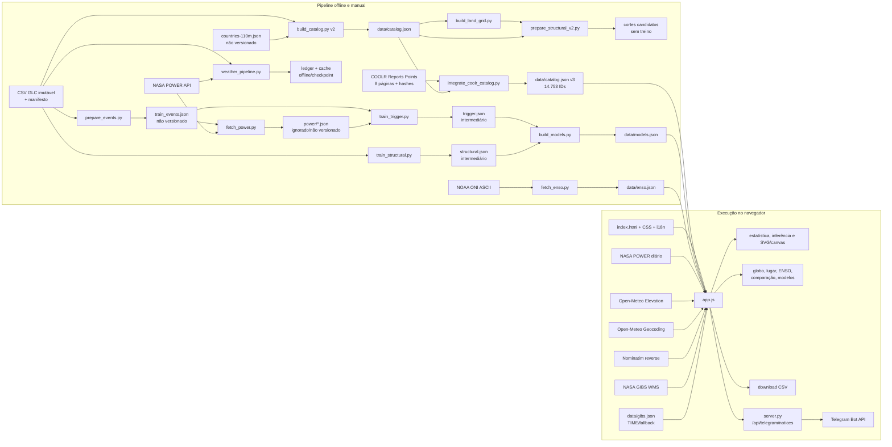

# Arquitetura

## Resumo verificado

A aplicação é uma SPA sem *framework* e sem processo de compilação. `index.html` define a página; `style.css` cuida da apresentação; `i18n.js` contém textos PT/EN/ES; `app.js` carrega dados, chama serviços, calcula estatísticas, executa inferência e renderiza SVG/canvas/Globe.gl. `server.py` serve os arquivos e oferece apenas status/envio Telegram; segredo e destinatário ficam no ambiente do servidor. Não existe fila, *service worker*, CI/CD ou configuração de hospedagem. O ledger SQLite existe somente no pipeline meteorológico offline e nunca no fluxo de requisições do site.

## Diagrama do fluxo de dados

Linhas contínuas representam fluxos confirmados. O pipeline offline só existe como scripts; não há agendador ou evidência de que tenha sido executado de forma automatizada.

## Componentes

| Componente | Responsabilidade | Evidência |
|---|---|---|
| `index.html` | estrutura das seções, formulários, diálogos e carregamento das bibliotecas CDN | `index.html:1-409` |
| `i18n.js` | conteúdo traduzido, rótulos dinâmicos e mensagens | objeto `I18N`, `i18n.js` |
| `app.js` | estado, APIs, cálculos, modelos, gráficos, cache e interações | IIFE assíncrona, `app.js:3-804` |
| `style.css` | layout responsivo e estilos | `style.css` |
| `data/catalog.json` | eventos schema v2 com identidade, nulidade, precisão, origem, contorno e comparações | carregado no início de `app.js` |
| `data/models.json` | células mensais do modelo estrutural e árvores do modelo de disparo | carregado em `app.js:34`, consumido em `app.js:103-123` |
| `data/enso.json` | série ONI e metadados de download | carregado em `app.js:34`, consumido em `app.js:45-65` |
| `data/gibs.json` | camada, `TIME`, data representada, fallback e verificação GIBS | carregado no início de `app.js` |
| `scripts/*.py` | construção manual dos artefatos | comandos em `README.md:59-70` |
| CDN | KaTeX, TopoJSON Client e Globe.gl | `index.html:402-404` |

## Fluxo de uma análise de lugar

1. A pesquisa chama Open-Meteo Geocoding. O clique no globo e a geolocalização consentida usam Nominatim apenas para nome reverso; a API de geolocalização só é chamada depois do clique em “Usar minha localização”.
2. `selectPlace` atualiza o histórico local imediatamente e inicia `study` (`app.js:496-517`).
3. `study` executa NASA POWER e elevação em paralelo; só a falha de elevação é convertida em `null` (`app.js:341-348`).
4. `analyze` usa a climatologia local 2001–2017 para as 16 entradas do modelo de disparo e a série disponível inteira para tendências e “dias de disparo” (`app.js:278-339`).
5. `predictTrig` percorre 200 árvores exportadas e aplica sigmoide (`app.js:116-121`).
6. O histórico vem de um filtro do catálogo pelo raio escolhido; a saída estrutural só é usada quando existe para a célula de 1° que contém o ponto (`app.js:111-115`, `358-389`).
7. A tela renderiza score recente, séries, tendência, ENSO, declividade, histórico e saída estrutural; o CSV é gerado somente após sucesso do POWER (`app.js:518-531`, `612-621`).

`renderSimpleResult` produz a leitura inicial e `renderPlace` produz os painéis detalhados a partir do mesmo `current.A`. `setAdvanced` apenas mostra ou oculta a área técnica; não repete consulta nem inferência.

## Estado e armazenamento

| Estado | Onde | Persistência | Observação |
|---|---|---|---|
| idioma | `localStorage['dd-lang']` | entre sessões | JSON serializado por `store` (`app.js:6-11`) |
| lugares comparados | `localStorage['dd-places']` | entre sessões | coordenadas e nomes (`app.js:660-668`) |
| estudos POWER/elevação | `Map cache` | só na aba | chave por coordenada com 3 casas; falhas removem entrada (`app.js:341-348`) |
| geolocalização atual | objeto `current.pl` | só na aba | latitude/longitude arredondadas a 3 casas; só entram em `localStorage` se a pessoa escolher explicitamente salvar para comparação |
| texturas GIBS | `Map gibsCache` | só na aba | falhas removem entrada (`app.js:172-180`) |
| artefatos de dados/modelos | arquivos estáticos | publicação | catálogo v2 tem linhagem; modelos atuais ainda não têm manifesto completo |

Não existe banco de dados. O cache HTTP do navegador/CDN pode atuar, mas não é configurado pelo código.

## Concorrência, tarefas e falhas

- POWER é serializado globalmente por `powerChain`; cada chamada tenta imediatamente e depois de 4 s e 10 s, com *timeout* de 90 s (`app.js:237-252`).
- A elevação tem *timeout* de 20 s e falha isoladamente; o restante da análise continua sem declividade (`app.js:254-258`, `341-346`).
- Geocoding usa *debounce* de 250 ms e *timeout* de 15 s (`app.js:260-263`, `624-638`).
- Reverse geocoding tem *timeout* de 12 s e retorna `null` em erro (`app.js:264-270`).
- Falha de POWER invalida a análise do lugar e oferece “Tentar de novo” (`app.js:484-516`).
- GIBS mostra erro próprio e volta a permitir nova tentativa (`app.js:198-209`).
- Não há tarefa em segundo plano, atualização agendada, fila, telemetria ou monitoramento.
- Treinamento e coleta não ocorrem em requisições do usuário; isso preserva o fluxo interativo conforme a regra operacional.

## Serviços externos

| Serviço | Chamada | Dados enviados | Papel |
|---|---|---|---|
| NASA POWER | `GET /api/temporal/daily/point` | latitude, longitude, período e parâmetros | séries meteorológicas |
| Open-Meteo Geocoding | `GET /v1/search` | texto digitado e idioma | busca |
| Open-Meteo Elevation | `GET /v1/elevation` | cinco pares de coordenadas | altitude/gradiente |
| Nominatim | `GET /reverse` | coordenada e idioma | nome do ponto |
| Geolocation API do navegador | `getCurrentPosition` depois do clique | permissão e leitura pelo navegador/sistema | coordenada aproximada para iniciar a mesma consulta de lugar |
| NASA GIBS | WMS `GetMap` e imagens de legenda | camada, caixa global e `TIME` quando temporal | textura do globo |
| Backend local | `GET /api/telegram/status`, `POST /api/telegram/notices` | payload validado; coordenada arredondada a duas casas | mantém token/`chat_id` fora do navegador |
| Telegram Bot API | `sendMessage` pelo backend | destinatário fixo e resumo técnico | envio manual; não é alerta oficial |
| Google Fonts/jsDelivr | recursos estáticos | metadados HTTP usuais | fontes e bibliotecas |

## Fronteiras de confiança e segurança

1. Todo código de terceiros de CDN e todo dado externo executa/entra no mesmo cliente. Não há *Subresource Integrity* nos scripts (`index.html:402-404`).
2. O envio Telegram passa por `server.py`; token e destino ficam no ambiente. O limite em memória protege uma instância, mas produção com múltiplas instâncias ainda exige rate limit compartilhado/proxy.
3. Textos de APIs são em geral inseridos com `textContent`; a interface usa `innerHTML` para strings internas.
4. Não há política de conteúdo, proxy controlado, autenticação, autorização ou trilha de auditoria para os demais serviços.

## Publicação

`.nojekyll` torna o conteúdo compatível com GitHub Pages, mas isso não prova que GitHub Pages seja o destino. `git remote -v` não retornou remoto; não há `CNAME`, workflow, Dockerfile ou configuração de outra plataforma. Portanto, local e método de publicação são **não verificados**.

## Pendências arquiteturais prioritárias

- configurar Telegram apenas por secret manager/ambiente e adicionar proteção distribuída antes de escalar;
- versionar um manifesto de artefatos e separar claramente dados atuais de previsões históricas congeladas;
- definir atualização offline promovida manualmente, com validação e *rollback*;
- adicionar testes de contrato/cálculo e uma verificação de navegador;
- decidir política de cache/proxy e conformidade de Nominatim antes de uso em escala.

Critérios e dependências estão em [plano-de-tarefas.md](plano-de-tarefas.md).
