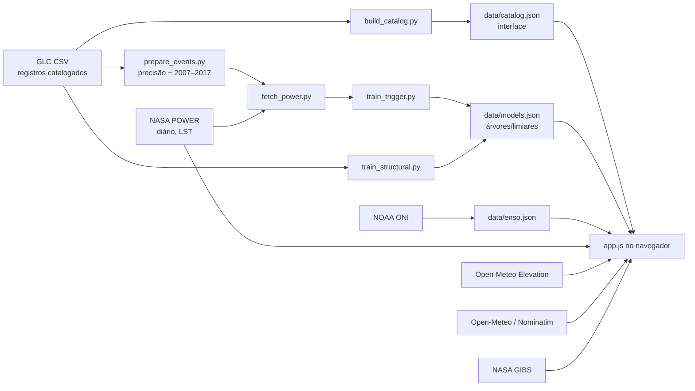

# Auditoria das bases e integrações

## Escopo, data e grau de certeza

Auditoria executada em 15/11/2026, sem retreinar ou substituir modelos. Foram avaliados os artefatos publicados, scripts de transformação/treino, um CSV obtido do endereço oficial do Global Landslide Catalog (GLC) e contratos de leitura das APIs. O objetivo é avaliar procedência, plausibilidade, consistência e compatibilidade; não comprovar a veracidade de todos os eventos nem a precisão local dos produtos em grade.

Termos usados neste documento:

- **confirmado**: reproduzido por script, inspeção do código/artefato ou resposta da fonte;
- **hipótese/suspeita**: mecanismo plausível, mas faltam os dados indicados;
- **não verificado**: metadado ou entrada indisponível;
- **registro observado/catalogado**: item do GLC, não necessariamente uma observação instrumental;
- **estimativa**: produto em grade, estatística derivada ou saída de modelo;
- **ausente**: não deve ser interpretado como zero, evento inexistente ou baixa ocorrência.

Comandos reproduzíveis:

```bash
python3 scripts/audit_data.py --strict
python3 scripts/audit_data.py --raw-glc /caminho/Global_Landslide_Catalog.csv --strict
python3 scripts/check_integrations.py --strict
```

O segundo comando depende de um CSV fornecido pelo operador. O terceiro depende de rede e verifica somente leitura. O Telegram não é chamado porque exigiria credencial e produziria efeito externo.

## Resultado executivo

- Os três artefatos locais passam nas verificações de esquema, referências, limites, datas e finitude implementadas em `scripts/audit_data.py`; isso não valida a verdade externa de cada valor.
- O CSV servido pelo portal NASA em 15/11/2026 tem 11.033 linhas, 31 campos, IDs únicos e período 1988–2017. Aplicar a transformação de `build_catalog.py` reproduz, como multiconjunto, 11.033/11.033 registros de `data/catalog.json`. A compatibilidade é **confirmada**; o arquivo original usado para gerar o artefato continua **não verificado**, pois seu hash não foi preservado.
- O período correto do artefato inteiro é 1988–2017: 10.988 registros estão em 2007–2017 e 45 são anteriores. A documentação inicial dizia 11.001/32, uma soma incorreta agora corrigida.
- As junções reproduzíveis do artefato associam 10.988/10.988 registros elegíveis tanto a uma célula estrutural quanto a um mês ONI, sem multiplicação. Isso verifica chaves, não adequação causal ou precisão espacial.
- O pipeline meteorológico parte de 9.351 registros com gatilhos não explicitamente excluídos e 7.957 pares únicos célula-data antes dos filtros POWER. O artefato relata 5.361 casos em 922 lugares. A perda e seu tamanho são **confirmados**; suas causas linha a linha não podem ser auditadas sem `power/` e intermediários do treino.
- O modelo estrutural tem uso de informação posterior na definição do domínio: o conjunto de células é construído com eventos de 2007–2017 antes dos cortes temporais. O vazamento de domínio é **confirmado**; o tamanho da inflação das métricas não foi medido e exigiria novo experimento, fora desta etapa.
- NASA POWER, Open-Meteo Elevation e Geocoding, Nominatim, quatro camadas GIBS e o arquivo ONI responderam ao teste de contrato em 15/11/2026. POWER identificou `MERRA2` na amostra histórica e `GEOSIT` na recente; responder não garante disponibilidade futura, atualidade de cada pixel ou precisão local.
- As chamadas POWER usam LST por padrão. O GLC não é normalizado por fuso no pipeline. Um deslocamento de dia é uma **suspeita**, não um erro medido.

## Fluxo auditado



Os intermediários entre `fetch_power.py` e `train_trigger.py` não estão versionados. A seta descreve o código existente, não uma execução integral reproduzida nesta auditoria.

## Inventário por fonte

### Global Landslide Catalog

| Item | Resultado auditado |
|---|---|
| Responsável e origem | NASA Open Data / Global Landslide Catalog, [página do conjunto](https://data.nasa.gov/dataset/global-landslide-catalog-export) e recurso CSV servido pelo portal |
| Versão, licença, obtenção | sem versão semântica; portal informa “licença não especificada”; arquivo de comparação obtido em 15/11/2026, 8.479.717 bytes, SHA-256 `2c4898899dd4f373c4320e121c5b655ebb5394d431fa42e57ec4828d07d48b04` |
| Período / publicação / atualização | eventos 1988–2017. A descrição do portal diz que a exportação estava atual até 07/03/2016, o que conflita com o arquivo servido; data de publicação/revisão do conteúdo não foi estabelecida |
| Cobertura e resolução | global, pontos de eventos catalogados; frequência irregular. `location_accuracy`: `exact` 1.386; 1 km 2.185; 5 km 3.178; 10 km 1.435; 25 km 1.470; 50 km 794; 100 km 25; 250 km 16; `unknown` 542; vazio 2 |
| Campos/tipos/unidades/CRS | 31 colunas CSV; principais: `event_id` texto, `event_date` data, longitude/latitude graus decimais WGS84, contagens de mortos/feridos, gatilho/categoria e metadados textuais. Fuso de `event_time` não é normalizado pelo projeto |
| Ausentes | o CSV pode ter vazio; `build_catalog.py` converte fatalidade vazia em zero, descarta coordenada não numérica e codifica data inválida como zero. No JSON, zero de fatalidade não distingue “zero observado” de ausente |
| Quantidades | bruto 11.033; coordenadas/datas válidas 11.033; descartados por coordenada no build 0; IDs ausentes 0; IDs duplicados 0; linhas completas duplicadas 0. No JSON compactado: 114 grupos idênticos, 135 linhas excedentes, gerados pela perda de ID/metadados/arredondamento, não confirmados como duplicatas reais |
| Uso | interface: pontos, contagens, mortes, gatilhos e histórico por raio; treino de ambos os modelos; não entra na inferência recente do modelo meteorológico, salvo por ter definido o modelo treinado |

Transformação confirmada em `scripts/build_catalog.py:7-20`: coordenadas arredondadas a 0,01°; `event_id`, `location_accuracy`, descrição e fontes não sobrevivem. Logo, os 11.033 itens da interface devem ser chamados de **registros do catálogo**, não 11.033 deslizamentos independentes comprovados.

### NASA POWER

| Item | Resultado auditado |
|---|---|
| Responsável e origem | NASA Prediction Of Worldwide Energy Resources, [Daily API](https://power.larc.nasa.gov/docs/services/api/temporal/daily/) |
| Versão, licença, obtenção | respostas de 15/11/2026 informaram API `v2.10.3`; amostras de 2001 e 2017 retornaram `MERRA2`, e novembro/2026 retornou `GEOSIT`. A data exata de transição não foi investigada; licença/termos não estão registrados no repositório |
| Período / atualização | treino solicita 01/01/2001–31/12/2017; interface solicita 01/01/1981 até o dia da consulta. Na amostra, havia dados até 10/11/2026; não equivale a garantia de atualização para todo local/parâmetro |
| Cobertura/resolução/frequência | global terrestre, diária; documentação POWER informa grade meteorológica nativa aproximadamente 0,5° latitude × 0,625° longitude; WGS84; `time_standard=LST` porque o projeto não fixa o parâmetro |
| Campos/unidades/ausentes | `PRECTOTCORR` mm/dia; `GWETTOP` e `GWETROOT` fração 0–1; `T2M` °C. Preenchimento `-999`; navegador converte a `NaN`, sem imputação (`app.js:247-252`) |
| Quantidades | dinâmicas por consulta. Contrato de Petrópolis testou 10 dias × 4 parâmetros, todos presentes. Contagens dos arquivos brutos de treino não verificáveis porque `power/` está ausente |
| Uso | treino e inferência do modelo meteorológico; séries recentes, tendências, ENSO local, CSV. Não é entrada do modelo estrutural |

O ponto consultado representa uma célula de produto em grade/reanálise, não um pluviômetro ou sensor de encosta. A chuva usada no caso é do dia catalogado; solo usa `t-1` (`train_trigger.py:54-64`). A correspondência de célula e data está implementada, mas a convenção de fuso entre evento e LST ainda não está validada.

### NOAA CPC ONI

| Item | Resultado auditado |
|---|---|
| Responsável e origem | NOAA Climate Prediction Center, [ONI ERSSTv5](https://www.cpc.ncep.noaa.gov/products/analysis_monitoring/enso/oni/v5/) e `oni.ascii.txt` |
| Versão, licença, obtenção | ERSSTv5; licença não registrada no repositório; `data/enso.json.updated=2026-11-14` representa execução do download, não publicação NOAA |
| Período / frequência | janeiro central de 1950 a setembro central/ASO de 2026; 921 estações sobrepostas mensais, sem lacunas no artefato |
| Cobertura/resolução/unidade | região Niño 3.4; média móvel trimestral de anomalia de TSM, °C; não é um dado espacial local do lugar pesquisado |
| Ausentes e quantidades | 921 registros locais válidos, chaves mensais únicas, zero ausentes/não finitos. O arquivo remoto tinha 921 linhas e o último valor ASO/2026 = 2,46, compatível com o local |
| Uso | classificação histórica ENSO, comparações e correlações; não é entrada dos dois modelos publicados |

Valores recentes são estimados/revisáveis. Desde 2026, o site agora informa que RONI é o indicador adotado para monitoramento oficial, enquanto conserva ONI para a série histórica.

### Open-Meteo Elevation e Geocoding

| Item | Elevation | Geocoding |
|---|---|---|
| Responsável/origem | Open-Meteo, [Elevation API](https://open-meteo.com/en/docs/elevation-api); Copernicus DEM GLO-90 | Open-Meteo, [Geocoding API](https://open-meteo.com/en/docs/geocoding-api); índice GeoNames |
| Versão/licença/obtenção | GLO-90 2021, 90 m; serviço declara CC BY 4.0; sob demanda, verificado 15/11/2026 | versão do índice não retornada; serviço declara CC BY 4.0/atribuição GeoNames; sob demanda |
| Cobertura/resolução | global, WGS84, 90 m nominal; elevação em metros | localidades globais, coordenadas WGS84; sem frequência temporal aplicável |
| Ausentes/quantidade | cinco amostras por estudo; falha vira indisponibilidade, não zero. Petrópolis: 831, 860, 815, 818 e 822 m | até sete candidatos; interface escolhe explicitamente a opção do usuário. A consulta de teste retornou cinco homônimos, primeiro em -22,505/-43,17861 |
| Uso | altitude e gradiente aproximado por diferenças centradas; não é declividade média/suscetibilidade | pesquisa de lugar; não entra nos modelos |

### Nominatim / OpenStreetMap

| Item | Resultado auditado |
|---|---|
| Responsável e origem | instância pública Nominatim da OpenStreetMap Foundation, [política de uso](https://operations.osmfoundation.org/policies/nominatim/) |
| Versão/licença/obtenção | versão do banco não exposta pelo projeto; resposta declara ODbL 1.0; sob demanda, verificado 15/11/2026 |
| Cobertura/resolução/frequência | cobertura OSM, geometria/nomes com qualidade variável; reverse em `zoom=10`; atualização do banco não verificada |
| Campos/ausentes | nome/endereço administrativo, coordenadas e IDs OSM; falha retorna `null` e preserva rótulo genérico |
| Quantidade/uso | uma consulta reversa por ponto clicado; Petrópolis retornou relação administrativa e nome. Usado somente para rótulo, não altera a coordenada nem os modelos |

O uso em escala precisa cumprir limite, identificação, cache e atribuição da política pública; o projeto ainda não possui backend/cache persistente.

### NASA GIBS / Worldview

| Item | Resultado auditado |
|---|---|
| Responsável/origem | NASA Earthdata GIBS, endpoint WMS `epsg4326/best` |
| Versão/licença/obtenção | versões/licenças por produto não são registradas no projeto; imagens obtidas sob demanda |
| Camadas | `IMERG_Precipitation_Rate`, `SMAP_L4_Analyzed_Root_Zone_Soil_Moisture`, `NDH_Landslide_Hazard_Distribution_2000`, `VIIRS_NOAA20_CorrectedReflectance_TrueColor` |
| Período/resolução | variam por camada e não foram extraídos do capabilities. NDH é histórica/2000; VIIRS recebe ontem; IMERG e SMAP são chamadas sem `TIME` |
| Quantidades/uso | quatro de quatro camadas retornaram PNG no teste. São apenas visualização do globo e não entram em treino/inferência |

HTTP 200/PNG confirma compatibilidade do identificador da camada, não a data ou presença de informação útil no pixel. A interface agora declara quando `TIME` não é enviado; DD-012 ainda deve resolver a data efetiva.

### Limites terrestres `world-atlas`

| Item | Resultado auditado |
|---|---|
| Responsável/origem | pacote `world-atlas@2.0.2`, derivado de Natural Earth 1:110m |
| Versão/licença/obtenção | package.json indica dados Natural Earth 4.1.0 e código ISC; Natural Earth é distribuído como domínio público. Data de obtenção original não preservada |
| Cobertura/resolução/CRS | limites globais generalizados 1:110m em coordenadas geográficas; sem dimensão temporal operacional |
| Campos/ausentes/quantidade | TopoJSON incorporado em `catalog.json.land`; o arquivo-fonte separado não está no repositório. Nomes de país/geométricos são usados como aproximação |
| Uso | textura/máscara terrestre e identificação aproximada; não deve validar limites administrativos locais |

### Artefatos derivados dos modelos

| Artefato | Versão/período | Campos e ausentes | Quantidade | Uso e limitação |
|---|---|---|---|---|
| `models.json.trig` | sem versão/data; clima 2001–2017, casos 2007–2017 | 16 atributos, base, 200 árvores, limiares e métricas; `missing_go_to_left` implementado | 5.361 casos, 922 lugares reportados; controles 1:4 | inferência recente. Score discriminativo de amostra caso-controle, não probabilidade calibrada nem perigo/risco |
| `models.json.grid` | sem versão/data; atributos finais 2012–2017 | célula 1°, 12 saídas inteiras/1.000; 7.727 valores mensais zero | 9.321 células únicas | saída histórica. A união `1-∏(1-p_m)` assume independência mensal não validada; não é risco atual |

## Junções, multiplicidade e compatibilidade

| Junção | Chave/regra real | Elegíveis | Associados | Não associados | Multiplicação | Conclusão |
|---|---|---:|---:|---:|---:|---|
| GLC → grade estrutural publicada | `floor(lat), floor(lon)` para 2007–2017 | 10.988 | 10.988 | 0 | 0, lookup por chave única | compatibilidade estrutural confirmada; não valida precisão dentro da célula |
| GLC → ONI | `year*12 + month - 1` | 10.988 | 10.988 | 0 | 0, um ONI por mês central | cobertura temporal confirmada |
| GLC → POWER no preparo | `round(lat/0.5), round(lon/0.625)` e data `YYYYMMDD` | 9.611 após ano/precisão | 8.197 célula-datas únicas | 1.414 registros coocorrentes colapsam no `set` posterior | não é join relacional; vários registros no mesmo dia/célula viram um caso |
| preparo → disparo, após rótulos excluídos | mesma célula/data | 9.351 registros / 7.957 célula-datas | 5.361 casos no artefato | 2.596 célula-datas antes dos controles | sem multiplicação conhecida | perda confirmada; causas não auditáveis sem POWER/intermediários |
| pesquisa → POWER/Elevation | latitude/longitude escolhida | 1 lugar | respostas presentes na amostra | 0 na amostra | nenhuma | APIs aceitam a coordenada; cada fonte resolve sua própria grade |

O arredondamento de POWER usa `round`, ao passo que o estrutural usa `floor`; são grades e finalidades distintas. Nenhuma delas representa a encosta pontual. Longitude, latitude e limites foram validados nos artefatos; não houve coordenadas fora de WGS84.

## Datas, fusos e informação posterior

1. **POWER versus evento — suspeita.** A API respondeu em LST. O evento usa apenas `event_date`, sem fuso ou conversão. Para eventos próximos da meia-noite, a chuva pode ser atribuída ao dia civil errado. Faltam hora/fuso normalizados e arquivos originais de treino para medir casos afetados.
2. **Solo antecedente — confirmado no código.** `GWETTOP`/`GWETROOT` usam `t-1`, enquanto as janelas de chuva incluem `t`; não foi encontrado uso explícito de dias posteriores ao evento no vetor de disparo (`train_trigger.py:54-64`).
3. **Climatologia retrospectiva — confirmado.** Percentis de 2001–2017 são usados inclusive para casos anteriores a 2017. Isso é normalização retrospectiva, mas seria informação futura em uma simulação operacional histórica; a validação temporal não refaz a climatologia somente com o passado.
4. **Domínio estrutural — vazamento confirmado.** `has` e `C` são construídos com eventos de todo 2007–2017 antes de `feats`/`labels` (`train_structural.py:8-21`). Assim, saber que uma região aparece até 2017 influencia quais negativos existem nos testes anteriores.
5. **Saída final estrutural — histórica.** O modelo final usa atributos 2012–2017 (`train_structural.py:66-74`); não há horizonte futuro explícito armazenado nem atualização automática. A interface foi corrigida para não chamá-la de condição de 2026.

## Duplicidade e sobreposição de catálogos

Há apenas um catálogo de eventos no projeto; portanto não existe sobreposição entre dois catálogos para medir. Dentro do GLC:

- zero `event_id` duplicado e zero linha CSV completa duplicada;
- 114 grupos/135 linhas excedentes tornam-se idênticos no JSON compacto;
- 141 grupos/166 linhas excedentes compartilham coordenada arredondada e data;
- um único episódio pode legitimamente ter vários movimentos/registros.

Conclusão: há **candidatos indistinguíveis após transformação**, não duplicatas confirmadas. DD-028 exige preservar `event_id` e revisar amostras; nenhuma linha foi removida nesta etapa.

## Valores fixos, imputados, fallbacks e atualidade

| Item | Tipo real | Comportamento/impacto |
|---|---|---|
| fatalidade vazia | coerção para zero | 8.591 registros têm zero no JSON, sem distinguir ausência; soma de 31.061 deve ser chamada de mortes registradas, não total completo |
| POWER `-999` | ausente → `NaN` | janela/ano pode ser descartado; não vira zero na análise |
| fração de chuva estrutural | fallback `-1` quando não há eventos locais | valor sentinela entra no modelo; não é uma fração observada (`train_structural.py:42-48`) |
| célula estrutural ausente | antes podia usar vizinha/baixo; agora `–` | corrigido: ausência não é baixa recorrência |
| ONI `updated` | data do download | não é data oficial de publicação ou garantia de valor definitivo |
| GIBS chuva/solo | WMS sem `TIME` | data efetiva não demonstrada; limitação agora visível |
| NDH | camada histórica 2000 | não é perigo em tempo real |
| modelo estrutural | atributos até 2017 | antigo/histórico; agora rotulado assim |
| Telegram | resumo estimado | modo demonstrativo/experimental; não é alerta oficial. Token no cliente continua inadequado para publicação operacional |

Não foram encontrados dados sintéticos inseridos nos artefatos científicos. Controles negativos do modelo de disparo são **amostras construídas** (quatro dias comuns aleatórios por caso, semente 42), não observações de “não houve deslizamento” comprovado.

## Rastreamento de uma amostra da interface

Amostra: **Petrópolis**, coordenada padrão da aplicação `-22,505 / -43,1786`, raio 250 km.

| Resultado exibido/derivado | Rastro até a origem | Resultado verificado | Limitação |
|---|---|---|---|
| lugar pesquisado | Open-Meteo Geocoding → primeiro candidato com essas coordenadas | nome/coord. compatíveis | há homônimos; usuário deve escolher o candidato |
| nome do clique | Nominatim reverse na coordenada | “Petrópolis, Rio de Janeiro…” | nome administrativo, não valida encosta |
| histórico | `catalog.json.pts` → Haversine ≤250 km (`app.js:367-376`) | 166 registros, 1.455 mortes registradas, 2007–2016 | raio inclui região ampla; ausência fora do catálogo não é ausência real |
| recorrência histórica | célula direta `floor(-22,505), floor(-43,1786)` = `(-23,-44)` | célula encontrada; valores mensais 0,033; 0,016; 0,023; 0,019; 0,016; 0,015; 0,018; 0,022; 0,024; 0,027; 0,102; 0,060; combinação 0,319491 | score histórico não calibrado; união mensal assume independência |
| chuva/solo/temperatura | chamada POWER na coordenada | quatro parâmetros, 01–10/11/2026, LST, fill `-999`, grade retornada -43,179/-22,505 | produto regional em grade; disponibilidade variá por data |
| altitude/gradiente | cinco amostras Open-Meteo GLO-90 | 831/860/815/818/822 m | gradiente aproximado; não declividade média ou suscetibilidade |
| ONI | `enso.json` → chave mensal | ASO/2026 = 2,46, igual ao arquivo NOAA no teste | valor recente revisável; não é leitura local |
| camadas | WMS GIBS | quatro IDs retornaram PNG | data de IMERG/SMAP sem `TIME`; PNG pode ser vazio no recorte/data |

## Matriz fonte → verificação → evidência → resultado → impacto → correção

| Fonte | Verificação | Evidência reproduzível | Resultado | Impacto | Correção/pendência |
|---|---|---|---|---|---|
| GLC CSV | contagem, campos, IDs, datas, coordenadas, hash | `audit_data.py --raw-glc ...` | 11.033; 31 campos; zero ID/full-row duplicado; tudo válido | base compatível, mas qualidade factual não comprovada | DD-030: versionar manifesto/metadados |
| GLC CSV → JSON | reproduzir `build_catalog.py` | `catalog_reproduction` no auditor | 11.033/11.033 correspondem, zero sobra | procedência atual fortalecida | preservar hash da entrada original; licença segue não especificada |
| GLC | precisão espacial | distribuição `location_accuracy` | só 1.386 `exact`; até 250 km/unknown | raio/célula parecem mais precisos que a fonte | carregar/exibir precisão; DD-030 |
| JSON compacto | duplicatas aparentes | `exact_duplicate_rows`, `same_coordinate_date_candidates` | 135 e 166 linhas excedentes candidatas | contagem pode agrupar eventos distintos; deduplicar seria arriscado | revisar por `event_id`; DD-028 |
| GLC → estrutural | chave e cobertura | `structural_join` | 10.988/10.988, zero multiplicação | artefato cobre todos os registros elegíveis por chave | manter teste de contrato |
| GLC → ONI | chave mensal | `oni_join` | 10.988/10.988, zero multiplicação | sem perda temporal do artefato | manter teste de contrato |
| GLC → preparo POWER | filtros e colapso | comparação bruta + `prepare_events.py` | 9.611 linhas; 8.197 célula-datas; 1.414 colapsadas | quantidade de registros não é quantidade de casos de treino | documentar unidade amostral |
| preparo → modelo de disparo | reconciliação de casos | 7.957 elegíveis antes de qualidade versus 5.361 no artefato | 2.596 não explicados linha a linha | possível viés regional/temporal | DD-027, requer `power/` original |
| POWER | contrato, unidade, produto, data, local/fuso | `check_integrations.py` | v2.10.3; 4 parâmetros; unidades esperadas; MERRA2 histórico/GEOSIT recente; LST; datas presentes | integração funciona na amostra; atribuir tudo a MERRA-2 seria incorreto | produto retornado agora aparece dinamicamente; fixar `time-standard`; DD-029 |
| POWER | informação posterior | `train_trigger.py:54-64` e climatologia 2001–2017 | vetor usa chuva até `t` e solo `t-1`; baseline inclui anos futuros para casos antigos | validação temporal não simula produção histórica estrita | refazer baseline por corte em futura validação; não retreinado aqui |
| modelo estrutural | domínio temporal | `train_structural.py:8-21,54-68` | células definidas com 2007–2017 antes do split | vazamento de domínio confirmado | DD-010 |
| ONI | continuidade e comparação remota | auditor local + `check_integrations.py` | 921, sem lacunas/duplicatas; último valor igual | série compatível com fonte no dia | registrar versão/revisão e separar download/publicação |
| Elevation | cinco amostras numéricas | `check_integrations.py` | 5/5 retornadas | cálculo executável | texto já limitado; DD-011 concluído |
| Geocoding | candidato e ambiguidade | `check_integrations.py` | primeiro compatível; cinco resultados | escolha automática incorreta seria possível sem UI de candidatos | manter lista/identificação administrativa |
| Nominatim | reverse e licença | `check_integrations.py` | nome e ODbL retornados | rótulo funciona; dependência sem SLA | DD-019 cache/proxy/política |
| GIBS | IDs e MIME | `check_integrations.py` | 4/4 PNG | camadas existem; data/conteúdo não provados | DD-012: capabilities + `TIME` + data na UI |
| Telegram | classificação e segredo | `app.js:534-610`, templates trilíngues | mensagem agora diz experimental/não alerta; token continua no navegador | semântica contida, segurança operacional não resolvida | DD-003: desabilitar em público ou mover a backend autenticado |

## Informações importantes exibidas e aceite de rastreabilidade

| Informação | Origem e período conhecido | Limitação que deve permanecer visível | Estado |
|---|---|---|---|
| registros/mortes/gatilhos | GLC local, 1988–2017 | cobertura de notícias, precisão variável, ausente de fatalidade vira zero | rastreável; nulidade ainda precisa de novo esquema |
| histórico no raio | GLC, 1988–2017 | nenhum registro ≠ nenhum deslizamento | sinalizado |
| score meteorológico | POWER recente + modelo treinado em 2001/2007–2017 | não calibrado, escala regional, não alerta/probabilidade | texto corrigido; manifesto do modelo pendente |
| saída estrutural | GLC, atributos até 2017 | histórica, vazamento de domínio, não risco atual | texto corrigido; modelo não substituído |
| chuva/solo/temperatura | POWER 1981–última data retornada | grade/reanálise, LST e ausentes | data real mostrada pela série |
| tendências | POWER, anos com ≥360 dias válidos | teste não corrige toda dependência serial; IC é OLS, não Sen | rastreável |
| ENSO | NOAA ONI 1950–ASO/2026 no arquivo | revisável, global e histórico; RONI oficial desde 2026 | sinalizado |
| gradiente/altitude | GLO-90 2021, consulta atual | cinco amostras, não avalia suscetibilidade | texto corrigido |
| mapas GIBS | GIBS sob demanda | data de chuva/solo não demonstrada | limitação sinalizada; correção funcional pendente |

O critério de aceite foi atendido quanto à identificação de origem, período e limitações das informações principais. Ainda não foi atendido quanto à reprodução integral dos modelos, preservação de nulidade/precisão do GLC, data efetiva das camadas GIBS e segurança operacional do Telegram. Esses itens permanecem no mesmo [plano de tarefas](plano-de-tarefas.md), com dependências e critérios de aceite.

## Verificações executadas e limites

| Verificação | Resultado em 15/11/2026 | Limite |
|---|---|---|
| `python3 scripts/audit_data.py --strict --summary` | passou; 11.033 registros, 9.321 células, 921 ONI, zero problema estrutural classificado como fatal | audita artefatos finais, não verdade externa |
| `python3 scripts/audit_data.py --raw-glc /tmp/dd_glc_official.csv --strict` | passou; reprodução 11.033/11.033 | arquivo em `/tmp` não integra o repositório; entrada original segue sem hash |
| `python3 scripts/check_integrations.py --strict` | primeira execução no sandbox falhou por DNS; execução com rede confirmou todas as integrações após corrigir a comparação de estação ONI no verificador | amostra única, sem SLA, Telegram excluído |
| sintaxe Python/JS e JSON | prevista no fechamento desta etapa | não substitui teste de navegador |

Próxima ação mínima: obter/preservar os intermediários POWER do treino ou refazer um candidato versionado sem promovê-lo, para explicar DD-027; em paralelo, DD-012 e DD-029 podem avançar sem retreino.

## Adendo pós-auditoria — preparação de 15/11/2026

Este adendo não reabre nem substitui a matriz acima; registra as correções posteriores:

| Fonte/fluxo | Verificação nova | Evidência | Resultado | Impacto/correção |
|---|---|---|---|---|
| GLC bruto → catálogo | hash do manifesto + comparação em ordem de 11.033 campos rastreáveis | `data/sources/glc/2026-11-15/manifest.json`, `build_catalog.py`, `audit_data.py` | 11.033/11.033; IDs únicos; 1.385 fatalidades e duas precisões ausentes preservadas | DD-006/DD-028/DD-030 concluídas para a nova linhagem |
| COOLR atual | metadados/contagem, hashes e integração por `event_id` | `audit_coolr.py`, `analyze_coolr_snapshot.py`, `integrate_coolr_catalog.py` | 14.753 IDs publicados = 11.030 comuns substituídos + 3.720 só COOLR + 3 só locais; 13.116 datados e 14.726 georreferenciáveis | aplicado ao mapa/histórico; não atualiza modelos; versão/licença seguem não verificadas |
| GLC → POWER novo | ledger por candidato/tentativa e reconciliação | `weather_pipeline.py`, execução piloto | 8.197 = 240 excluídos + 4 válidos + 7.953 pendentes | perdas futuras ficam explicáveis; DD-027 histórica continua bloqueada e DD-032 está em andamento |
| evento → POWER | teste de corte D−1 em LST | `test_temporal_alignment.py` | quatro testes passaram | regra preditiva nova explícita; não reconstrói o instante dos eventos antigos |
| domínio estrutural | grade independente + partições reservadas | `build_land_grid.py`, `prepare_structural_v2.py` | 29.496 células; 51 registros fora; nenhum treino | vazamento de domínio antigo confirmado; DD-010/DD-033 permanecem |
| GIBS | capabilities + GetMap com `TIME` | `data/gibs.json`, `update_gibs_metadata.py` | quatro imagens; fallbacks IMERG/SMAP exibidos | DD-012 concluída; data de acesso não é usada como data dos dados |
| Telegram | varredura + contrato do backend | `server.py`, `app.js`, `tests/test_telegram_backend.py` | token/`chat_id` ausentes das respostas; payload fixo, coordenada arredondada, 3 pedidos/10 min/IP | função restaurada sem segredo no navegador; token compartilhado não foi persistido e deve ser substituído |

Verificação pós-integração: `python3 scripts/audit_data.py --strict --summary` encontrou 14.753 registros, 9.321 células estruturais e zero problema fatal; 20 testes locais passaram. Os detalhes operacionais, limitações e prontidão dos dois modelos estão em [preparacao-dados.md](preparacao-dados.md). Nenhum modelo foi retreinado ou promovido.
